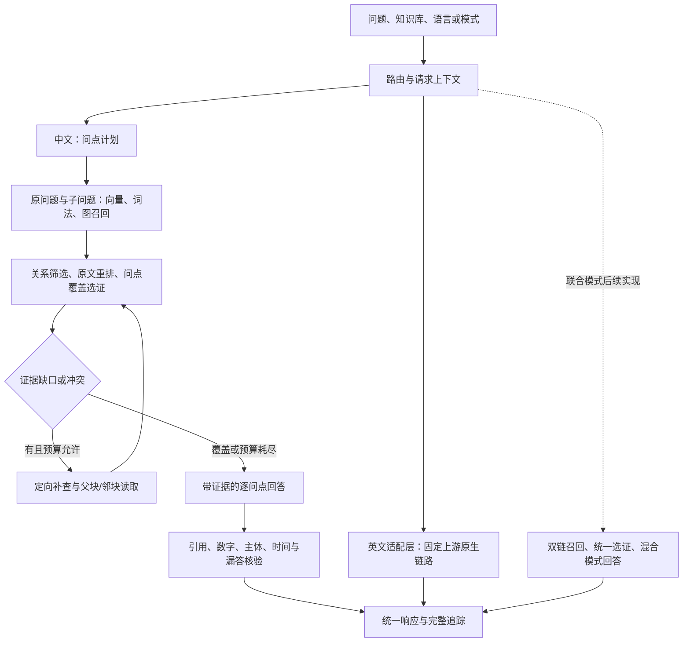

# 中英文双链路架构规划

> 更新：首版底座和两条链路已实现。本文保留最初的目标设计，实际完成范围与边界见 [首版实现与验收](首版实现与验收.md)。

规划日期：2026-11-12。状态：待实施；以下模型、预算和接口为设计建议，不代表已经完成验证。

## 1. 核心决策

中文需要重构查询编排，不需要推倒已有的文档处理和评测基础。英文采用上游固定版本的原生链路，通过独立适配层接入。优先完成两种语言各自的检索与问答，再增加跨语言联合检索。

准确率优先意味着允许更多召回、较强模型、补查和核验，不意味着无限上下文或无限循环。每次新增模型调用都应能在逐题日志中解释其用途，并通过消融验证贡献。

首版采用 Python 模块化应用、Milvus 服务及元数据存储；模型推理独立部署。暂不引入 Neo4j，也不把每个处理步骤拆成微服务。共享存储服务与运维不等于共享向量空间或强制统一算法。

## 2. 中文为什么需要新编排

依据轻量版 500 题运行 `.vgrag-eval/crud-500.lqeu5e` 及其 `review/summary.json`、`review/coverage.json`：

| 已有观察 | 对新版的约束 |
| --- | --- |
| 2,309 份原文、2,993 段，归一化后没有发现切分删除原文 | 保留解析和结构切分基础；不能把问题全归因于片段长度 |
| 59 道三文档题候选来源齐全而最终来源缺失，41 道最终不足 8 段 | 排序应检查各问点的独有事实，单纯增大最终 Top K 不够 |
| 上述 59 题中，11 题被归为参考要点在候选中但未选中；38 题原评已完整答对 | 引入事实覆盖诊断；不能把 59 题都当作可挽回的错误 |
| 53 道来源齐全但原评未完整答对的题，52 道连标准来源的所有切片都在最终证据中 | 需要回答阶段核验，继续堆检索不能解释这批问题 |
| 这 53 题主要处理方向为回答问题 20、题目/参考歧义 12、评分存疑 21 | 算法优化与评测质量修正分别报告 |

这些是离线复盘的主要处理分类，不是互斥因果证明，也没有重新评分。原运行完整答对率仍为 387/500（77.4%）。此前的 79.1% 属于另一套历史千题流程，不能作为新配置或本次 500 题的成绩。轻量版最新提示词和候选合并修复也尚未获得新的付费准确率结果。

## 3. 总体结构

共享模块：`DocumentStore`、`IndexManifest`、模型服务适配、快照与任务管理、追踪、评测、API/CLI。英文本身的生成与排序保留在上游链路内，统一响应层只做字段映射。

语言路由支持 `auto / zh / en / both`。文档语言与问题语言分别记录；数字、代码、专名不能单独作为语言判断依据。允许调用者明确指定。首期 `auto` 只在明确的单语言知识库中自动路由；混合知识库应提示或按显式配置选择链路，不能静默漏查另一种语言。`both` 在联合模式实现前明确返回不支持。

## 4. 英文：固定上游，保持边界

上游基准：`zilliztech/vector-graph-rag@1c034849fb36a104dadb1ddf967abcfe5bbd99b7`。

直接采用其英文方案，不另起一轮英文算法评选，不以中文改造覆盖英文行为。依赖固定 commit，封装 `EnglishUpstreamPipeline`，记录依赖版本、解析/切分规则、索引配置、各任务模型及完整参数。优先通过公开 API 适配；必须补充观测接口时用最小补丁并单独记录。

首个可执行档案建议命名 `en_upstream_jev_1_13`：使用当前源码原生支持的固定 Jev 1.13 两阶段流程，最终 K、嵌入、抽取和回答模型显式配置。不要使用浮动 `latest`。上游当前裸 `jev` 指向 1.13；文档发布的 1.14 冻结实验通过另一服务接口运行，不能改个别名就声称接入了该实验。

应区分两个被信任但用途不同的资产：

- 上游已发表的冻结评测及其历史候选/模型配方，作为引用的英文检索证据保存；不要求重复付费评测。
- 固定源码的可运行英文档案，作为产品链路接入；如果目标指定为 1.14 的完整实验配方，应单列适配任务，显式支持对应服务、图与原文嵌入配置，不把它混称为现成默认值。

冻结实验的检索召回成绩不能标成整个新产品的答案准确率。这个区分仅用于配置和指标命名，不重新质疑英文实验。

保留上游 Jev 的关系评分、关系回溯原文、图与直接向量候选合并、原文评分流程及错误语义；不在英文默认路径额外塞入中文问点规划器、BM25、重答器或中文切分器。已有英文完整段落数据保持原粒度，普通文件按上游加载和切分配置处理。

适配层需补足稳定证据标识。不能仅按返回文本任意匹配一个来源：建立索引侧 ID/文本/来源映射，保留重复正文的全部来源别名，遇到无法唯一定位的结果显式标识引用歧义。

英文验收是接线与行为一致性检查：相同配置、相同测试输入，对比原生 API 与适配层的选择顺序和输出；覆盖 metadata filter、失败传播、重复正文引用。使用模拟响应做离线契约测试，不新增付费全量实验。

## 5. 中文：以事实覆盖为核心

### 5.1 文档与切分

复用轻量版 TXT/Markdown/DOCX/PDF 解析、原文偏移与页码定位、表格结构、完整句边界。切分器改为可注入 tokenizer 和配置，避免将 BGE-small 的 512 token 上限固化成产品上限。

新增“原始文件 → 逻辑文章 → 章节/父块 → 检索子块”关系，以及同一逻辑文章内的前后邻块。来源追踪同时保留原文件 ID 与文章 ID。检测新闻拼接、导航/版权区、超长假标题、主体/日期突变；存在歧义时保留原文并标注，不能自动把两篇文章的事实拼成同一事件。

第一轮只加父块/邻块关系，保留当前切分参数作为对照。后续再分别比较更大子块和上下文回填；不同时改模型与切分后把收益归因于其中一个。长上下文模型能接收更多文本，不代表整篇嵌入的召回更准确。

### 5.2 实体和关系

保留上游“实体/关系向量 + 邻接 ID + 原文回溯”结构。中文取消硬编码每段至多 4 条关系的限制，改为按片段信息量和任务预算配置。抽取结果必须回指原文证据。

扩展可选字段：实体别名、主体、关系、客体、时间、地点、数值/单位、否定或条件、证据 span。关系是否完整与抽取是否成功分别标记，空关系、格式错误、服务失败不得混记。必要时按结构分批抽取并重试失败部分，仍失败则保留向量/词法可检索的原文与失败记录。

跨语言同名和缩写不直接合并；只有原文明确别名或可追溯映射时才关联。不要把所有事实强行压进单个三元组；表格和复杂条件仍以原文为最终依据。

### 5.3 问点规划和召回

将复合问题拆成少量 `QuestionSlot`：要回答什么、目标主体、时间/范围/比较维度、依赖哪个前置实体。始终保留原问题召回通道；简单问题可直接作为一个 slot，避免误拆造成损失。计划器不提前编造事实，也不读取评测标准答案。

中文候选召回包含：

1. 原问题和各子问题的 dense 检索。
2. BM25 词法检索，补专名、缩写、编号、数值等精确线索；中文分词与数字归一化需专门测试。
3. 实体/关系检索及图扩展，优先找到桥接实体。允许配置扩展深度，默认先一跳，二跳由问题依赖或缺口触发。

中文模型首个升级候选为 BGE-M3 dense；词法通道先用独立 BM25。BGE-M3 learned sparse、multi-vector 属于后续消融选项，不与 BM25 混称，也不默认全部启用。关系嵌入可先复用中文 dense 模型，接口支持以后独立配置。

合并时保留通道、子问题和原始排名，可用 RRF 形成初始候选池；不同模型的原始相似度不直接相加。精确重复正文减少上下文占用但保留全部来源别名，不能因标题相同就合并不同事实。

### 5.4 两阶段选证和补查

参考上游“先筛关系、再评原文”的分工，不将它固定的英文候选上限照搬成中文能力上限。

先用可替换的 cross-encoder 筛掉明显无关原文，BGE-reranker-v2-m3 为首个候选；再用较强的中文模型对候选进行问点级证据判断。模型应输出支持哪些 slot、对应的逐字引文、主体/时间约束与冲突，不只返回一个排名列表。引文必须在原文中定位，定位失败不能算覆盖。

选证目标是在 token 预算内覆盖全部可回答的 slot、桥接关系和必要限定条件。支持一个局部事实的片段也有价值。不能因为某段不能独立回答整题就淘汰，也不能把“每来源至少一段”当成完整性证明。

模型判断覆盖只是推断，应与离线标注核验；逐字引文存在也不自动证明推论正确。后续消融决定 cross-encoder 是否造成过早丢证，必要时保留每个 slot 的候选保底配额。

发现缺口时，仅对缺口定向检索：补主体别名、桥接实体、时间范围或关键词；必要时读父块/邻块。邻块读取限制在同一逻辑文章内，并标记新增事实来自哪一段。最多补查 2 轮，无新增证据、预算耗尽或故障时停止，输出仍缺的问点。

### 5.5 回答与核验

回答模型接收 slot → 证据映射，先组织逐项事实，再形成自然语言答复。每项主张引用稳定 passage/span ID。缺证的问点单独说明，不能因一个指标无法比较就拒答全部问题。

增加独立核验阶段，检查：问点漏答、主体错配、时间错配、数值/单位/分母复制错误、引用不存在、无依据推断及证据冲突。可确定的数值和引用问题先用规则检查，语义支持关系用模型检查。

核验发现答案遗漏但证据已足，只修复回答；证据不足且补查预算仍有余量时回到补查。整个请求共享最大 2 轮补查和最多 1 次回答修复预算，不能形成互相调用的无限循环。核验模型不使用评测 gold，核验意见也不作为最终正确性的真值。

## 6. 数据、索引和可复现性

建议实体：`SourceDocument`、`LogicalDocument`、`Block`、`Passage`、`Relation`、`EvidenceSpan`、`QuestionSlot`、`RetrievalTrace`、`RunManifest`。来源 ID、内容 hash、语言、文章边界、位置、父子/邻接关系与版本为一等字段。

同一 Milvus 服务按知识库、语言、快照与模型配置隔离 collection。英文可沿用自己的实体/关系/原文 collection；中文使用自己的 dense、词法和图结构。不同 embedding 模型及向量维度不得混写。共享 canonical 原文并不要求两种语言共用切分或向量。

本机元数据先采用 SQLite，服务部署可换 PostgreSQL；Milvus 存向量与关联字段，原始文件及不可变证据快照进入文件/对象存储。数据库选型不作为准确率收益的来源。

索引 manifest 包含原文、切分器、tokenizer、模型标识/版本/维度、图抽取配置、collection schema 与实际内容摘要。禁止只检查数量：相同 ID/数量但正文、metadata、向量或关系变动也必须被完整性验收发现。构建时记录规范化内容/向量校验值；严格评测前校验实际存储。线上通过不可变快照、写入控制与定期完整性审计降低开销，不必每个请求扫描全库。

新索引构建到新快照，完整性检查通过后切换 active 指针，失败保留旧快照。更新/删除按 source version 传播到向量、关系、词法索引与引用映射，不留下旧关系。请求固定 snapshot ID，避免检索与补查读取不同版本。

同一索引比较不同查询策略时，固定数据、切分、嵌入和关系抽取，仅修改查询策略。模型或切分变化需要分别建索引，不能为了声称“同一套索引”强行共用旧向量。英文与中文从来不要求共用同一个 collection。

## 7. 联合模式的独立边界

中英文双链路不等于每次都检索两次。先保证原生 `zh` 和 `en` 可独立运行。

后续 `both` 为独立档案：保留原问题，并生成受约束的查询译文；中文走中文候选链，英文走上游 `retrieve()`，证据保留原文和语言。两侧分数经 rank fusion 或统一重排处理，不直接比较相似度。统一生成器按用户语言作答并引用原语证据。

英文只输入问题时仍调用原生 `query()`。联合模式新增了选证与生成，不能再标为未经改动的英文上游流程；联合检索的收益与翻译错误需要单独验收。

## 8. 部署和初始预算

本机 Mac 16 GB 可以开发和运行编排、元数据、小规模索引，较大的嵌入/重排/生成通过 API 或 GPU 服务运行。模型服务按角色配置 endpoint、model、版本、超时、并发和缓存，密钥不随索引或评测 manifest 序列化。

以下是待小样本调优的起点，不是最佳参数结论，也不影响英文固定配方：

| 中文阶段 | 初始实验范围 |
| --- | --- |
| 每个问题/子问题 dense、BM25 | 各 Top 20–40，受总候选池约束 |
| 合并候选池 | 约 80–120 段，按 slot 保留候选 |
| cross-encoder 后供语义选证 | 约 24–40 段，分批且全文不静默截断 |
| 最终回答证据 | 以 token 总量和覆盖为主，首轮比较 8k/16k；不固定每题必须多少段 |
| 补查 / 回答修复 | 最多 2 轮 / 最多 1 次 |

抽取、规划、选证、回答、核验不必使用同一模型；模型选择先用用户已有服务做固定对照，再比较更强模型。身份未知或超长内容导致的拒绝、截断、限流都写入 trace，不能伪装成“无证据”。索引期和查询期费用、缓存命中、延迟分别统计。

## 9. 开发与验收顺序

### 阶段 A：底座和英文接入

建立 package、配置、证据模型、快照 manifest、API/CLI 与 upstream adapter。保持英文原生链路，迁移文档处理与评测器。

验收：离线契约测试；两个知识库隔离；重复正文引用；失败状态传播；同数量内容篡改被拦截；中断后恢复且不重复计数；模型与索引不匹配阻止运行。此阶段不需要付费千题。

### 阶段 B：中文证据链重构

先让旧 BGE-small 和已有切分通过新接口运行，建立行为对照；再逐项加入问点规划、覆盖选证、父/邻块补查、回答核验。保留原模型条件便于定位架构收益。

验收：将 59 + 53 道已复盘案例作为开发回归集，逐题对照丢失事实、补查原因、修复内容。它们已经用于开发诊断，不能作为未见测试集。服务失败补跑和证据缺口补查分别记录，不混作同一类重试。

### 阶段 C：召回和模型升级

加入 BGE-M3、BM25、较强重排/回答服务；先独立比较召回改善，再组合架构。每轮固定其余因素。同配置查询策略比较共用快照，嵌入/切分实验各自建索引。

少量有费用的实验在用户后续授权的范围内进行；当前规划阶段不运行。评测语料必须包含干扰材料，不能只给 gold 文档。保留未用于提示词开发的验证题；现有历史千题已被多轮查看，最终泛化验证应补充新题/新语料。

### 阶段 D：联合检索与发布

新增 mixed-language 数据和问题、查询翻译、跨语言实体映射与联合回答。完成两条原生链路后再实现，避免一开始无法区分是中文、英文还是融合造成变化。

发布门槛：中文候选事实召回、最终事实覆盖、完整答对率分别改善且关键题型无明显退化；评测同时报告延迟和成本，展示改善/退化的成对题目并给置信区间。具体提升数值在基线固定后设定，不承诺未经实验的 90% 或某个涨幅。

所有阶段保留原始 grader 分数；参考/评分纠错单独版本化并人工审计。新增系统核验器不能兼任唯一评测真值。主要指标为完整答对率、关键事实覆盖、引用正确性；来源 Recall@K 是辅助诊断。

## 10. 代码和资料依据

以下上游链接固定到已核对的提交，文档与实现都已查看：

- [主流程 rag.py](https://github.com/zilliztech/vector-graph-rag/blob/1c034849fb36a104dadb1ddf967abcfe5bbd99b7/src/vector_graph_rag/rag.py)：query/retrieve、关系回溯和 Jev 原文阶段。
- [Jev 实现](https://github.com/zilliztech/vector-graph-rag/blob/1c034849fb36a104dadb1ddf967abcfe5bbd99b7/src/vector_graph_rag/llm/jev.py)：关系与原文独立评分、候选合并、完整响应验证。
- [图扩展](https://github.com/zilliztech/vector-graph-rag/blob/1c034849fb36a104dadb1ddf967abcfe5bbd99b7/src/vector_graph_rag/graph/knowledge_graph.py)：基于 ID 的惰性邻居访问。
- [上游切分](https://github.com/zilliztech/vector-graph-rag/blob/1c034849fb36a104dadb1ddf967abcfe5bbd99b7/src/vector_graph_rag/loaders/chunker.py)：默认字符预算；不替换现有中文结构切分。
- [模型和两阶段说明](https://github.com/zilliztech/vector-graph-rag/blob/1c034849fb36a104dadb1ddf967abcfe5bbd99b7/docs/guides/reranking.md)、[冻结评测](https://github.com/zilliztech/vector-graph-rag/tree/1c034849fb36a104dadb1ddf967abcfe5bbd99b7/evaluation/jev/two-stage)：实验配方与可执行默认配置的边界。
- [BGE-M3 官方模型卡](https://huggingface.co/BAAI/bge-m3)、[BGE-reranker-v2-m3 官方模型卡](https://huggingface.co/BAAI/bge-reranker-v2-m3)：作为模型候选能力依据，并非在本中文数据上的收益证明。

本地基准为 `vector-graph-rag-chinese-light@1ba62ecfc7a15af3d412f7039a68b389080fad4f`。其未提交的 `EVALUATION.md` 另有历史记录，本规划不修改它。详细复用路径见 [代码复用与重构清单](代码复用与重构清单.md)。
